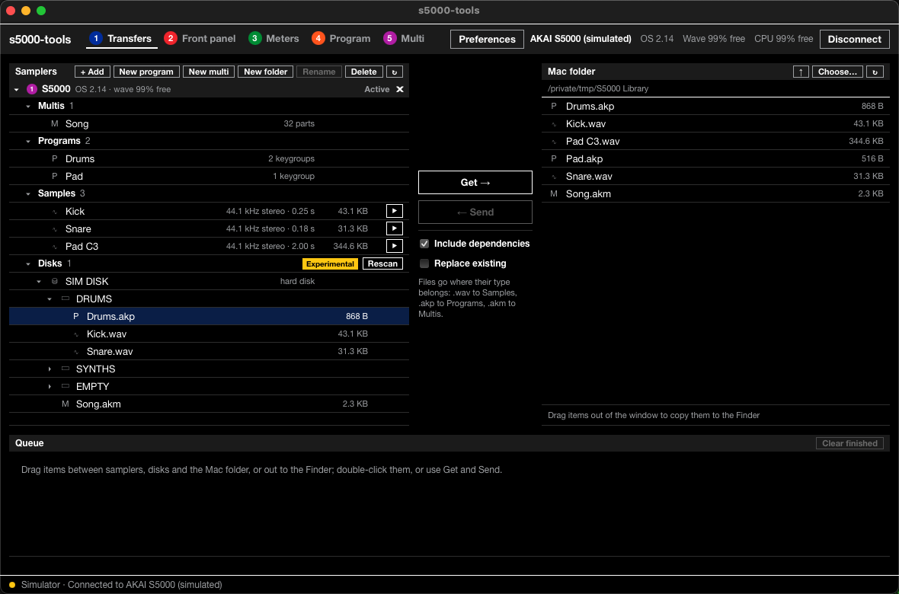
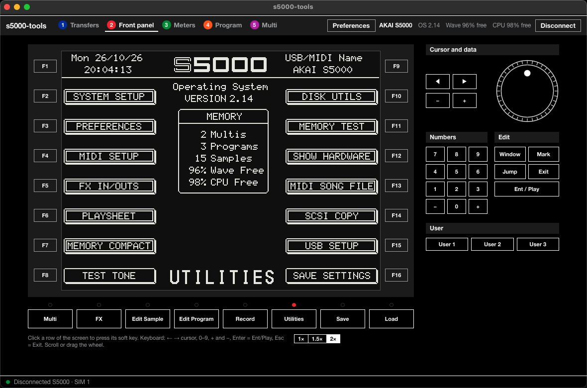
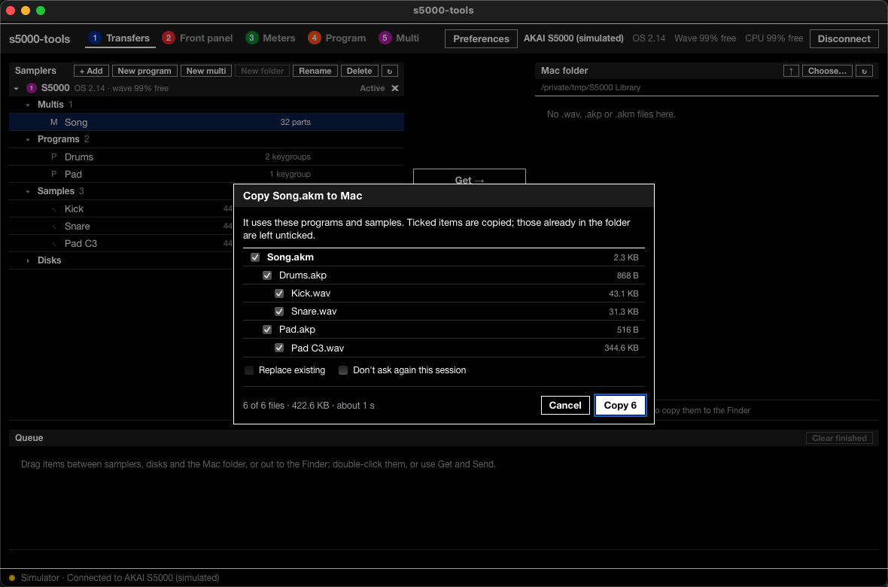
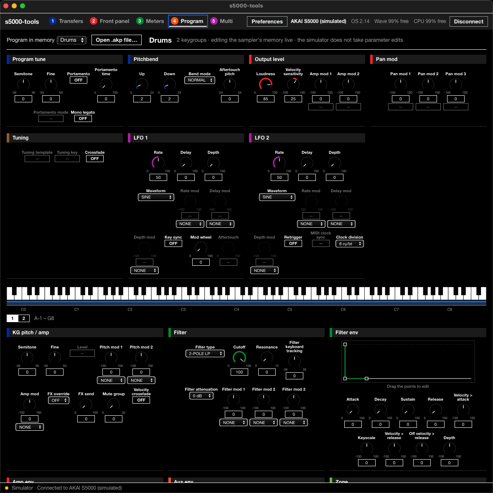
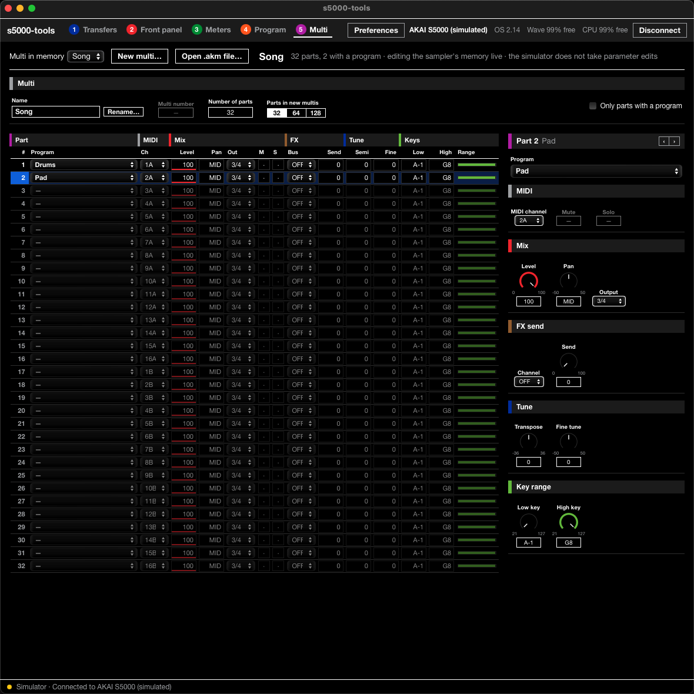

# s5000-tools

Open tools for the **Akai S5000/S6000** sampler over USB: transfer samples,
programs and multis, edit them, view the front panel and meters. They
replace Akai's Windows-only ak.Sys on macOS, Linux and Windows.

> **Alpha.** This works for its author on one sampler. It may still do
> something unexpected on yours: keep backups of anything you care about,
> and please [report](https://github.com/tbxx/s5000-tools/issues) what works
> and what doesn't, with your model, OS version and computer.



| | |
|---|---|
|  |  |
| **Front panel**: the live screen; click a row or its key | **Dependencies**: programs and multis bring what they use |
|  |  |
| **Program editor**: every setting, live | **Multi editor**: the parts table, live |

## What's here

- **The app**:
  - **Transfers:** a tree of each connected sampler's memory and disks. Drag
    between the sampler, a Mac/PC folder, the Finder and other samplers.
    Programs and multis bring their samples and programs along.
  - **Front panel:** the live screen with clickable soft keys.
  - **Meters.**
  - **Program editor:** live, including draggable envelopes.
  - **Multi editor:** the parts table (program, MIDI channel, level, pan,
    output, mute/solo, FX, tuning, key range), live.
- **Meters** in nine styles: LED and plasma bargraphs and moving-coil VUs,
  modelled on classic studio consoles.
- **Preferences** (⌘, / Ctrl+,): interface size (also ⌘+ / ⌘−, Ctrl on
  Windows and Linux), colour scheme (System, Light, Dark, Studio, Ivory, High
  contrast) and meter style, each with a live preview, and connecting to
  samplers automatically when the app starts or when one is switched on.
- **`s5k`**, a command-line tool for the same jobs; see
  [docs/cli.md](docs/cli.md).

## Tested so far

| | Status |
|---|---|
| S5000, OS 2.14, macOS 14 (Apple Silicon) | Works: transfers in both directions with dependencies, rename/delete/create, live parameter editing, front panel, meters |
| Disk operations (load, save, delete on the sampler's disks) | **Experimental.** Built from Akai's spec but untested on hardware; the app asks before the first one. One documented disk command restarts an S5000 and is never sent |
| S6000, OS 1.x, other OS 2.x versions | Untested; likely to work |
| Windows, Linux | Builds and passes tests; untested with a sampler |

## Install

Download the app or the `s5k` command for your system from
[Releases](https://github.com/tbxx/s5000-tools/releases). You need an
S5000/S6000 with OS 2.x and the USB interface board. Only one program can use
the sampler at a time, so quit ak.Sys (or release the sampler from any
virtual machine) first.

### macOS

No driver is needed. The app isn't signed by Apple yet, so the first time:

- **macOS 14 and earlier:** right-click the app, choose **Open**, then
  **Open** again.
- **macOS 15 and later:** open it once (it is blocked), then go to
  System Settings → Privacy & Security and click **Open Anyway**.

For the `s5k` command, remove the download quarantine:
`xattr -d com.apple.quarantine s5k`.

### Linux

Give your user access to the sampler with a udev rule. Create
`/etc/udev/rules.d/70-akai-s5000.rules` containing:

```
SUBSYSTEM=="usb", ATTRS{idVendor}=="09e8", ATTRS{idProduct}=="005e", MODE="0660", TAG+="uaccess"
```

Then run `sudo udevadm control --reload-rules && sudo udevadm trigger`, and
unplug and replug the sampler.

### Windows

Windows 10 or later, 64-bit (the app's WebView2 and current Rust no longer
support Windows 7). The tools talk to the sampler through Microsoft's generic **WinUSB** driver,
which you install for the sampler with [Zadig](https://zadig.akeo.ie):

1. Connect and switch on the sampler, then run Zadig.
2. Choose **Options → List All Devices**, then select the Akai sampler.
3. Choose **WinUSB** as the driver and click **Replace Driver**.

> **This replaces Akai's driver, so ak.Sys stops working** until you switch
> back. To return to Akai's driver: in Device Manager, right-click the
> sampler, choose **Uninstall device**, tick **Delete the driver software for
> this device** (or **Attempt to remove the driver**), then unplug and replug
> the sampler. Windows then uses Akai's driver again, if it is installed.

## Known issues

- On Windows and Linux, dragging items out of the app fetches them before
  the drop (on macOS nothing is copied until you drop).
- Quitting the app in the middle of a transfer or screen update can leave the
  sampler showing "USB Write Timeout". Press OK on the sampler to continue.

## Building

```
cargo build --release -p s5k-cli          # the s5k command
cd app && npm install && npx tauri dev    # the editor app (see app/README.md)
cargo test
# optional: check a folder of your own files (nothing leaves your machine)
S5K_LIBRARY=/path/to/files cargo test --release -p s5k-formats --test library -- --ignored
# with a sampler connected and nothing else using it (adds and removes test items)
S5K_HARDWARE=1 cargo test -p s5000-tools-app hardware -- --ignored --test-threads=1
```

Pushing a `v*` tag builds release files for every system into a draft GitHub
release (`.github/workflows/release.yml`).

| Crate | Purpose |
|---|---|
| `s5k-formats` | read and write `.akp`, `.akm`, `.wav` |
| `s5k-protocol` | message framing, encodings, transfers (no I/O) |
| `s5k-usb` | USB transport (nusb) |
| `s5k` | client library: memory, transfers, disks, panel, meters |
| `s5k-cli` | the `s5k` command |
| `app/` | the editor app (Tauri + Svelte) |
| `spec/` | parameter catalog generated into the tools |

- [docs/cli.md](docs/cli.md): using the `s5k` command
- [docs/protocol.md](docs/protocol.md): the USB protocol
- [docs/file-formats.md](docs/file-formats.md): `.akp`, `.akm` and `.wav` layouts
- [docs/effects.md](docs/effects.md): the EB20 effects board
- [docs/capturing.md](docs/capturing.md): how the protocol was captured
- [tools/](tools/): Python research scripts

## Planned

- An effects editor in the app.
- Confirming disk operations on hardware.
- Signed and notarised macOS builds.

## Credits

The SysEx command set is defined in Akai's **S5000/S6000 MIDI System
Exclusive Protocol Specification, version 2.10**, which is cited here, not
reproduced. The file-transfer framing was first documented by
[aksy](https://github.com/watzo/aksy) (Walco van Loon). The USB layer,
transfers, screen and meters were worked out from captures of ak.Sys
traffic.

Akai, S5000, S6000 and ak.Sys are trademarks of their owners. This project is
not affiliated with or endorsed by Akai Professional.

## License

[MIT](LICENSE)
